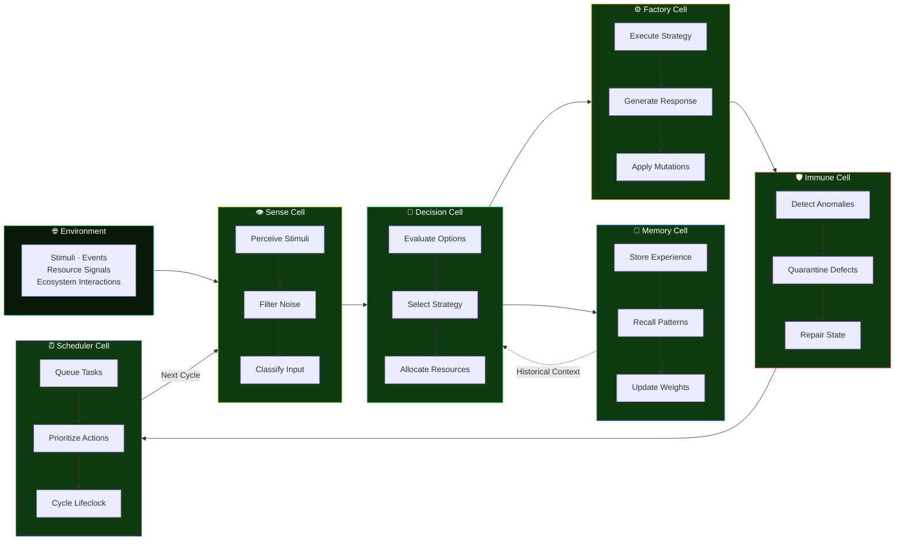
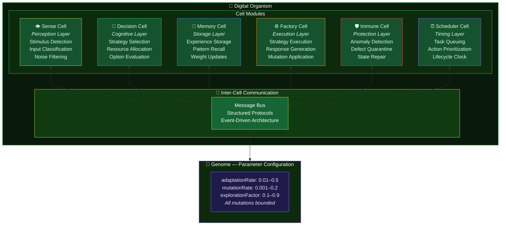
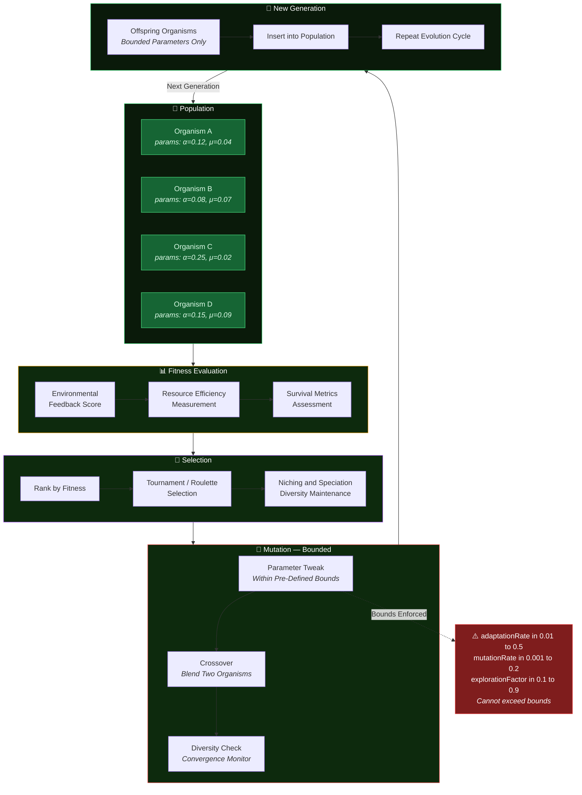
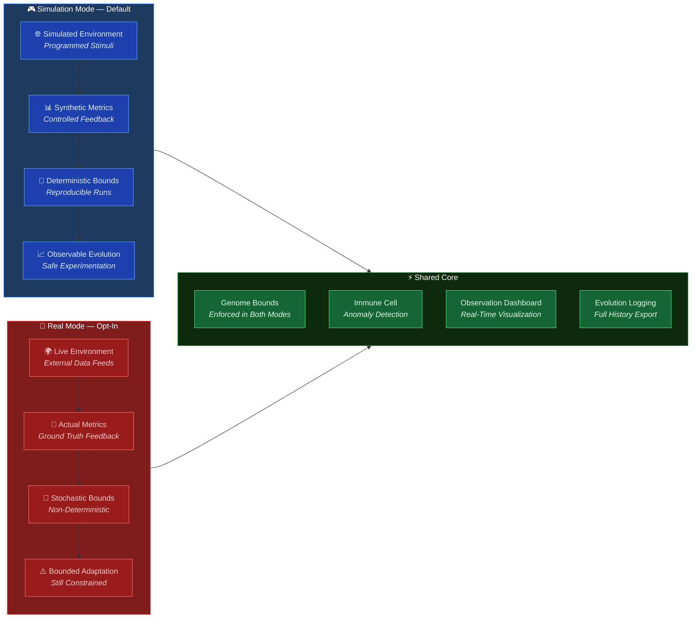

<!-- BANNER -->


<!-- TYPING SVG -->
<div align="center">
  <a href="https://git.io/typing-svg">
    
  </a>
</div>

<br/>

<!-- BADGES -->
<div align="center">

[](https://www.typescriptlang.org/)
[](https://nodejs.org/)
[](#)
[](./LICENSE)

</div>

---

## Overview

**Autonomous Organism** is an experimental research project exploring the concept of a self-evolving digital entity. Built in TypeScript, it implements a system where a software "organism" can adjust its own operational parameters — behavior patterns, response strategies, resource allocation — within defined bounds, simulating a form of digital adaptation and evolution.

This is a research artifact, not a product. It investigates questions about self-modifying systems, emergent behavior from simple rules, and the boundaries between programmed adaptation and genuine autonomy.

## Features

### Self-Adjustment Engine
- Parameter mutation within defined bounds
- Fitness-based selection of parameter configurations
- Environmental feedback integration
- Historical adaptation logging and analysis

### Organism Architecture
- Modular "cell" system with specialized functions
- Inter-cell communication protocols
- Resource allocation and energy management
- Lifecycle management (growth, adaptation, reproduction)

### Environmental System
- Simulated environment with variable conditions
- Stimulus generation and event scheduling
- Resource distribution modeling
- Ecosystem interaction simulation

### Evolution Mechanics
- Population-level evolution across organism instances
- Crossover and mutation operators
- Niching and speciation detection
- Convergence monitoring and diversity maintenance

### Observability
- Real-time parameter visualization
- Evolution timeline and lineage tracking
- Behavioral pattern analysis dashboards
- Export of evolution data for offline analysis

## Honest Notes

> **Clearing up misconceptions:**

- **Experimental Research Project** — This is a research prototype for studying self-modifying systems. It is not a product, service, or tool for general use.
- **"Self-Evolving" is Limited** — The self-evolution in this project refers to **parameter adjustment within pre-defined bounds**. The organism can tweak its own settings, not rewrite its fundamental code or create entirely new capabilities. This is bounded, constrained adaptation — not open-ended evolution.
- **Not AGI** — This project does not implement artificial general intelligence. The "organism" follows programmed rules with adjustable parameters. There is no understanding, consciousness, or general reasoning capability.
- **Not Sentient** — Despite the biological metaphor, the digital organism has no awareness, feelings, or subjective experience. Terms like "organism," "evolution," and "lifecycle" are metaphors for software patterns.
- **Emergent Behavior is Simple** — While the system can produce interesting emergent patterns, these emerge from the interaction of simple rules, not from any form of intelligence or intentionality.

## Quick Start

### Prerequisites
- Node.js 18+
- TypeScript 5.x

### Installation

```bash
git clone https://github.com/mulkymalikuldhrs/autonomous-organism.git
cd autonomous-organism
npm install
```

### Running

```bash
# Start with default configuration

<!-- AUTO-PACKAGE-BADGES:START -->

<!-- AUTO-PACKAGE-BADGES:END -->
npm run start

# Start with custom environment config
npm run start -- --config ./configs/complex-env.json

# Start observation dashboard
npm run observe

# Run evolution simulation
npm run simulate -- --generations 100 --population 50
```

### Configuration

```json
{
  "organism": {
    "initialParameters": {
      "adaptationRate": 0.1,
      "mutationRate": 0.05,
      "explorationFactor": 0.3
    },
    "bounds": {
      "adaptationRate": [0.01, 0.5],
      "mutationRate": [0.001, 0.2],
      "explorationFactor": [0.1, 0.9]
    }
  },
  "environment": {
    "resourceAbundance": 0.6,
    "volatility": 0.3,
    "stimulusFrequency": 1000
  }
}
```

## Project Structure

```
autonomous-organism/
├── src/
│   ├── organism/        # Core organism implementation
│   │   ├── cells/       # Specialized cell modules
│   │   ├── genome/      # Parameter & configuration management
│   │   └── lifecycle/   # Growth & adaptation phases
│   ├── environment/     # Simulated world
│   │   ├── stimuli/     # Environmental events
│   │   ├── resources/   # Resource modeling
│   │   └── ecosystem/   # Multi-organism interactions
│   ├── evolution/       # Population-level evolution
│   │   ├── selection/   # Fitness evaluation
│   │   ├── operators/   # Crossover & mutation
│   │   └── tracking/    # Lineage & history
│   ├── observation/     # Monitoring & visualization
│   └── types/           # TypeScript definitions
├── configs/             # Environment configurations
├── data/                # Evolution data exports
└── tests/               # Test suites
```

## Visual Architecture

> Interactive Mermaid diagrams showing organism lifecycle, cell interactions, and honest project limitations.

### 1. Organism Lifecycle — Biological Metaphor Pipeline

The digital organism follows a biological metaphor from sensing the environment to producing a response:



### 2. Cell System Architecture

Six specialized cell modules interact like biological cells — each with a defined role, communicating through inter-cell protocols:



### 3. Evolution Mechanics

Fitness-based selection with bounded mutation — the organism adapts within defined constraints:



### 4. Real vs Simulation Mode

Two operating modes — simulation is the default, real mode requires explicit opt-in:



### 5. Honest Limitations — What It Can and Cannot Do

Full transparency about the boundaries of this research project:

```mermaid
flowchart LR
    subgraph CAN["✅ What It CAN Do"]
        direction TB
        C1["🔧 Adjust operational<br/>parameters within bounds<br/><i>Bounded adaptation</i>"]
        C2["📊 Produce emergent patterns<br/>from simple rule interactions<br/><i>Non-intelligent emergence</i>"]
        C3["🔄 Run population-level<br/>evolution simulations<br/><i>Parameter optimization</i>"]
        C4["📈 Visualize adaptation<br/>in real-time<br/><i>Research observability</i>"]
        C5["💾 Log evolution history<br/>for offline analysis<br/><i>Full lineage tracking</i>"]
    end

    subgraph CANNOT["❌ What It CANNOT Do"]
        direction TB
        N1["🧠 General reasoning<br/>or understanding<br/><i>Not AGI</i>"]
        N2["💭 Feel, be aware,<br/>or have experiences<br/><i>Not Sentient</i>"]
        N3["🚀 Create entirely new<br/>capabilities or rewrite<br/>its own code<br/><i>Not Open-Ended</i>"]
        N4["🎯 Pursue goals or<br/>have intentions<br/><i>No Agency</i>"]
        N5["🧬 Evolve beyond<br/>pre-defined parameter<br/>bounds<br/><i>Bounded Only</i>"]
    end

    CAN ~~~ CANNOT

    style CAN fill:#14532d,stroke:#22c55e,color:#fff
    style CANNOT fill:#7f1d1d,stroke:#ef4444,color:#fff
    style C1 fill:#166534,stroke:#4ade80,color:#dcfce7
    style C2 fill:#166534,stroke:#4ade80,color:#dcfce7
    style C3 fill:#166534,stroke:#4ade80,color:#dcfce7
    style C4 fill:#166534,stroke:#4ade80,color:#dcfce7
    style C5 fill:#166534,stroke:#4ade80,color:#dcfce7
    style N1 fill:#991b1b,stroke:#f87171,color:#fecaca
    style N2 fill:#991b1b,stroke:#f87171,color:#fecaca
    style N3 fill:#991b1b,stroke:#f87171,color:#fecaca
    style N4 fill:#991b1b,stroke:#f87171,color:#fecaca
    style N5 fill:#991b1b,stroke:#f87171,color:#fecaca
```



> **Bottom line**: This is a research prototype for studying self-modifying systems. It adjusts parameters within bounds — it does not reason, feel, or evolve beyond its constraints. Biological terminology is metaphorical.

---

## Contributing

Contributions from researchers, students, and the curious are welcome:

1. Fork the repository
2. Create a research branch
3. Document your hypothesis and methodology
4. Submit a pull request with findings

Interesting contribution areas:
- New cell types and specializations
- More sophisticated environment models
- Better visualization and analysis tools
- Cross-organism communication protocols

## Disclaimer

This is an experimental research project for educational and academic exploration. The biological terminology used (organism, evolution, lifecycle) are metaphors for software patterns and do not imply biological properties. The project does not create sentient or conscious entities. The authors are not responsible for misinterpretation of the project's capabilities.

## License

This project is licensed under the **MIT License** — see the [LICENSE](./LICENSE) file for details.

## Author

<div align="center">

**Mulky Malikul Dhaher**

[](https://github.com/mulkymalikuldhrs)
[](mailto:mulkymalikudhr@mail.com)

</div>

---

<!-- FOOTER BANNER -->

